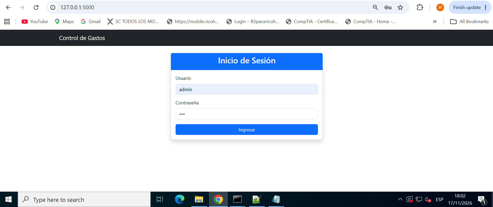
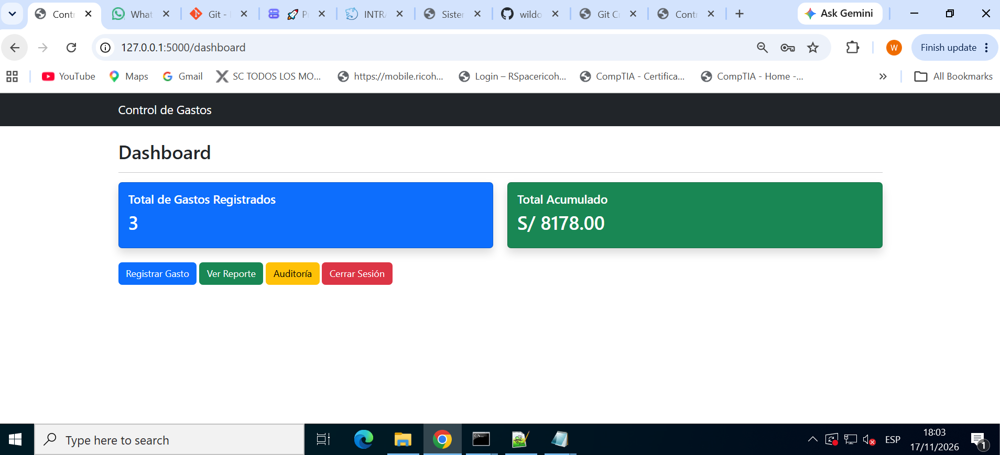
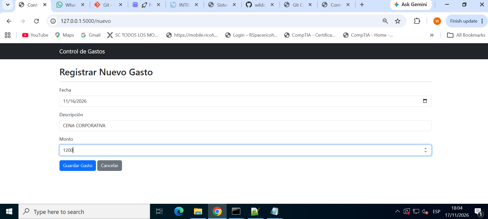
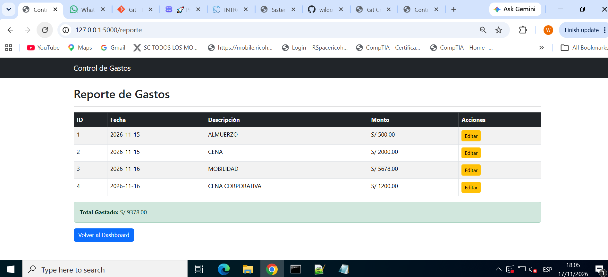
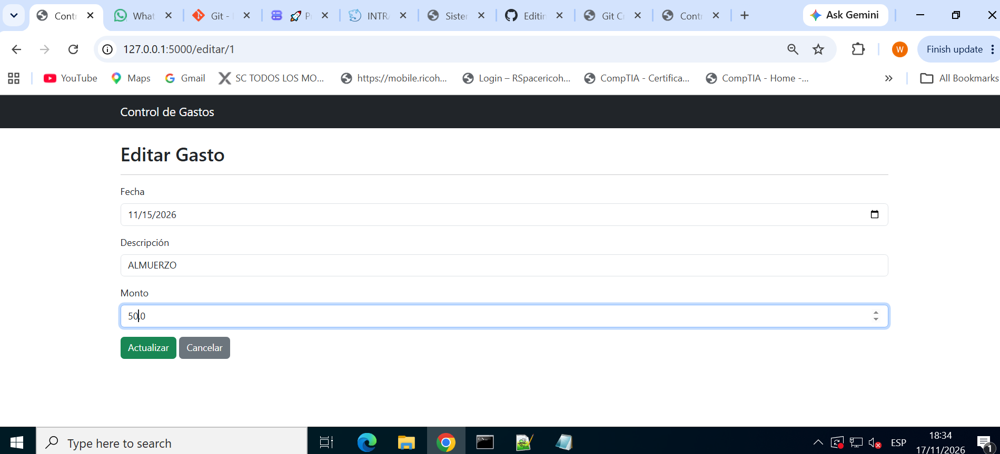
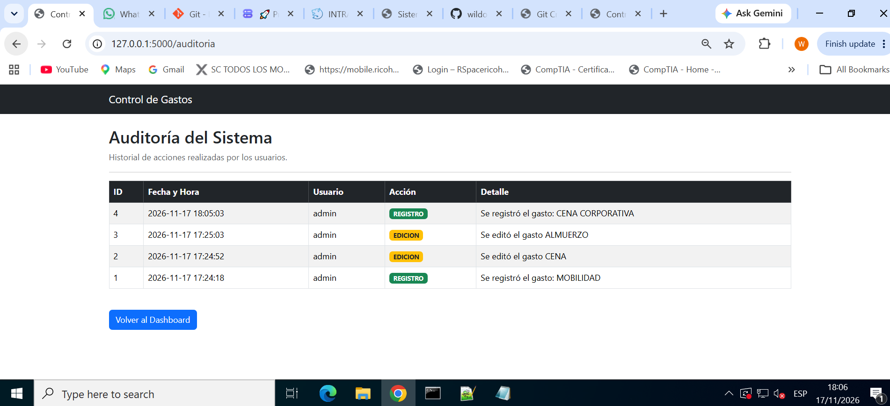

# Sistema de Control de Gastos

## Descripción

Aplicación web desarrollada con Python, Flask y SQLite que permite registrar, consultar y editar gastos personales.

El sistema incorpora autenticación mediante credenciales predefinidas, almacenamiento persistente utilizando SQLite y un módulo de auditoría que registra las acciones realizadas por los usuarios dentro de la aplicación.

---

## Tecnologías Utilizadas

- Python 3
- Flask
- SQLite
- SQLAlchemy
- Bootstrap 5
- HTML5

---

## Credenciales de Acceso

Usuario:

```text
admin
```

Contraseña:

```text
123
```

---

## Funcionalidades

### Inicio de Sesión

Permite acceder al sistema mediante autenticación de usuario utilizando credenciales previamente configuradas.



---

### Dashboard

Pantalla principal del sistema donde se muestran indicadores generales y accesos rápidos a las funcionalidades disponibles.

Características:

- Total de gastos registrados.
- Monto total acumulado.
- Acceso al registro de gastos.
- Acceso al reporte.
- Acceso a la auditoría.



---

### Registro de Gastos

Permite registrar nuevos gastos indicando:

- Fecha
- Descripción
- Monto

Toda la información es almacenada en una base de datos SQLite.



---

### Reporte de Gastos

Permite consultar todos los gastos registrados en el sistema y visualizar el monto total acumulado.



---

### Edición de Gastos

Permite modificar información previamente registrada cuando existan errores o actualizaciones en los datos.



---

### Auditoría

Permite visualizar las acciones realizadas por los usuarios dentro del sistema.

Cada registro almacena:

- Fecha y hora.
- Usuario.
- Acción realizada.
- Detalle de la operación.

Acciones auditadas:

- Registro de gastos.
- Edición de gastos.



---

## Estructura del Proyecto

```text
gastos_app/
│
├── app.py
├── models.py
├── requirements.txt
│
├── templates/
│   ├── base.html
│   ├── login.html
│   ├── dashboard.html
│   ├── nuevo_gasto.html
│   ├── editar_gasto.html
│   ├── reporte.html
│   └── auditoria.html
│
├── imagenes/
│   ├── login.png
│   ├── dashboard.png
│   ├── nuevo_gasto.png
│   ├── editar_gasto.png
│   ├── reporte.png
│   └── auditoria.png
│
└── instance/
```

---

## Instalación

### Clonar repositorio

```bash
git clone https://github.com/wildorconcepcion-create/gastos-app.git
```

### Ingresar al proyecto

```bash
cd gastos_app
```

### Crear entorno virtual

```bash
python -m venv .venv
```

### Activar entorno virtual

Windows:

```bash
.venv\Scripts\activate
```

### Instalar dependencias

```bash
pip install -r requirements.txt
```

### Ejecutar aplicación

```bash
python app.py
```

---

## Funcionamiento

1. Iniciar sesión con las credenciales proporcionadas.
2. Acceder al Dashboard principal.
3. Registrar gastos indicando fecha, descripción y monto.
4. Consultar el reporte general de gastos.
5. Editar registros cuando sea necesario.
6. Revisar el historial de auditoría para visualizar las acciones realizadas.

---

## Autor

Wildor Alfredo Concepción Raico
